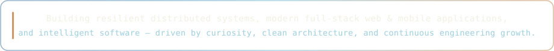

<div align="center">

  <!-- Animated Futuristic Hero Banner -->
  

  <br/><br/>

  <!-- Animated Typing Effect -->
  <a href="https://git.io/typing-svg">
    
  </a>

  <p>
    
  </p>

  <!-- Quick Navigation & Social Badges -->
  <p>
    <a href="https://your-portfolio-link.com" target="_blank"></a>
    <a href="https://github.com/wishmitha2003" target="_blank"></a>
    <a href="https://www.linkedin.com/in/your-link/" target="_blank"></a>
    <a href="mailto:wishmitha0720@gmail.com"></a>
    <a href="https://wa.me/94XXXXXXXXX" target="_blank"></a>
    <a href="https://app.daily.dev/wishmithadevinda" target="_blank"></a>
  </p>

</div>

<br/>

---

## About Me

<div align="center">
  
</div>

```ts
const developer = {
  name: "Wishmitha Devinda Dharmarathna",
  education: "BSc (Hons) in Computer Science — SLIIT",
  interests: [
    "Artificial Intelligence",
    "Full-Stack Development",
    "Cybersecurity",
    "Software Engineering",
    "DevOps",
  ],
  ambition: "Become a world-renowned Computer Scientist & Software Engineer",
};
```

I am an undergraduate pursuing a **BSc (Hons) in Computer Science at SLIIT**, focused on turning complex engineering challenges into reliable, user-centered software — from fault-tolerant distributed backends to responsive web and mobile applications.

<br/>

---

## Technology Stack

> Tools, languages, and frameworks used across my repositories and engineering projects.

<div align="center">

| Category | Technologies &amp; Tools |
| :--- | :--- |
| **Programming Languages** |       |
| **Frontend Development** |       |
| **Backend Development** |      |
| **Databases** |   |
| **DevOps &amp; Cloud** |      |
| **Tools &amp; Technologies** |       |

</div>

<br/>

---

## GitHub Statistics

<div align="center">

<table>
  <tr>
    <td width="50%" align="center" valign="middle">
      <a href="https://github.com/wishmitha2003">
        
      </a>
    </td>
    <td width="50%" align="center" valign="middle">
      <a href="https://github.com/wishmitha2003">
        
      </a>
    </td>
  </tr>
  <tr>
    <td width="50%" align="center" valign="middle">
      <a href="https://github.com/wishmitha2003">
        
      </a>
    </td>
    <td width="50%" align="center" valign="middle">
      <a href="https://github.com/wishmitha2003">
        
      </a>
    </td>
  </tr>
  <tr>
    <td colspan="2" align="center" valign="middle">
      <a href="https://github.com/wishmitha2003">
        
      </a>
    </td>
  </tr>
</table>

</div>

<br/>

---

## Connect With Me

<div align="center">

  <p>
    Open to collaborating on AI, full-stack engineering, distributed systems, and open-source projects.
  </p>

  <p>
    <a href="https://your-portfolio-link.com" target="_blank"></a>
    <a href="https://github.com/wishmitha2003" target="_blank"></a>
    <a href="https://www.linkedin.com/in/your-link/" target="_blank"></a>
    <a href="mailto:wishmitha0720@gmail.com"></a>
    <a href="https://wa.me/94XXXXXXXXX" target="_blank"></a>
    <a href="https://app.daily.dev/wishmithadevinda" target="_blank"></a>
  </p>

  <br/>

  <a href="https://app.daily.dev/wishmithadevinda" target="_blank">
    
  </a>

</div>

<br/>

---

## Footer

<div align="center">

  

  <br/><br/>

  

</div>
