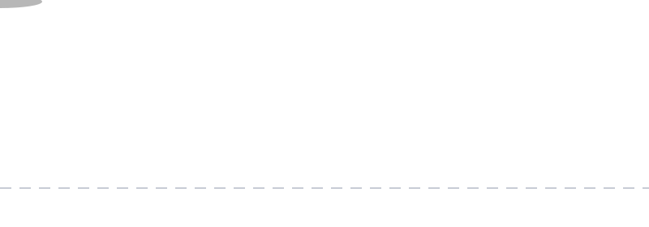

  <!-- Animated Futuristic Hero Banner -->
  

    

  <!-- Animated Typing Effect -->
  

  

    Building resilient distributed systems, modern full-stack web &amp; mobile applications, and intelligent software — driven by curiosity, clean architecture, and continuous engineering growth.
  

  <!-- Quick Navigation & Social Badges -->
  

    
    
    
    
  

 

---

## About Me

<table>
  <tr>
    <td width="64%" valign="top">
      

        I am <strong>Wishmitha Devinda Dharmarathna</strong>, an undergraduate pursuing a <strong>BSc (Hons) in Computer Science at SLIIT</strong>. I enjoy turning complex problems into reliable, user-focused software — from fault-tolerant distributed backends to responsive web and mobile interfaces.
      

      <ul>
        <li><strong>Academic Focus:</strong> Software Engineering, Distributed Systems, Object-Oriented Design, and Computer Science fundamentals.</li>
        <li><strong>Core Interests:</strong> Artificial Intelligence, Full-Stack Development, Cybersecurity, Software Engineering, and DevOps.</li>
        <li><strong>Long-Term Ambition:</strong> To grow into a world-renowned Computer Scientist and Software Engineer building impactful, scalable systems.</li>
      </ul>
    </td>
    <td width="36%" align="center" valign="middle">
      
       
      <code>status: building_the_future</code>
    </td>
  </tr>
</table>

 

---

## Technology Stack

> Tools, languages, and frameworks used across my repositories and engineering projects.

| Category | Technologies &amp; Tools |
| :--- | :--- |
| **Programming Languages** |       |
| **Frontend Development** |       |
| **Backend Development** |      |
| **Databases** |   |
| **DevOps &amp; Cloud** |      |
| **Tools &amp; Technologies** |       |

 

---

## GitHub Statistics

  <!-- GitHub Stats & Streak -->
  
  

    

  <!-- Top Languages & Profile Summary -->
  
  

    

  <!-- Contribution Activity Graph -->
  

 

---

## Featured Projects

> Selected public repositories showcasing distributed systems, full-stack engineering, mobile development, and browser productivity tools.

<table>
  <tr>
    <td width="50%" valign="top">
      <h3><a href="https://github.com/wishmitha2003/DS">DS / DistributedS</a></h3>
      

        Fault-tolerant distributed messaging system built on a leader–follower architecture with replication, heartbeat-based failure detection, automatic failover, Raft-style consensus, logical clock ordering, and node recovery.
      

      

        <code>Java</code> • <code>Docker</code> • <code>Apache ZooKeeper</code> • <code>HTML/CSS/JS</code>
      

      

        <a href="https://github.com/wishmitha2003/DS">DS Repo</a> • <a href="https://github.com/wishmitha2003/DistributedS">DistributedS Repo</a>
      

    </td>
    <td width="50%" valign="top">
      <h3><a href="https://github.com/wishmitha2003/SEWEB">EzyEnglish (SEWEB &amp; SEBACK)</a></h3>
      

        Full-stack interactive English learning platform featuring a React + Tailwind + Phaser web client and a Spring Boot 3 REST API with JWT authentication, BCrypt encryption, role-based access control, and MongoDB Atlas.
      

      

        <code>React</code> • <code>Tailwind CSS</code> • <code>Java 17</code> • <code>Spring Boot</code> • <code>MongoDB</code> • <code>Docker</code>
      

      

        <a href="https://github.com/wishmitha2003/SEWEB">Frontend</a> • <a href="https://github.com/wishmitha2003/SEBACK">Backend</a> • <a href="https://sewebsite.vercel.app">Live Demo</a>
      

    </td>
  </tr>
  <tr>
    <td width="50%" valign="top">
      <h3><a href="https://github.com/wishmitha2003/BODIMA">BODIMA</a></h3>
      

        Smart boarding-finder mobile platform designed for university students in Sri Lanka to discover, search, and compare verified boarding places while enabling owners to manage property listings.
      

      

        <code>Flutter</code> • <code>Dart</code> • <code>Material Design</code>
      

      

        <a href="https://github.com/wishmitha2003/BODIMA">View Repository</a>
      

    </td>
    <td width="50%" valign="top">
      <h3><a href="https://github.com/wishmitha2003/DueX">DueX</a></h3>
      

        Lightweight Chrome Extension (Manifest V3) helping students track assignment deadlines with real-time countdowns, structured deadline management, and smart reminders.
      

      

        <code>React</code> • <code>Vite</code> • <code>JavaScript</code> • <code>Chrome MV3</code>
      

      

        <a href="https://github.com/wishmitha2003/DueX">View Repository</a>
      

    </td>
  </tr>
  <tr>
    <td width="50%" valign="top">
      <h3><a href="https://github.com/wishmitha2003/Group34">Group34 Web Platform</a></h3>
      

        Modern collaborative web application built with a modular React + TypeScript + Tailwind CSS frontend, client-side PDF generation, and automated Vercel deployment.
      

      

        <code>TypeScript</code> • <code>React</code> • <code>Vite</code> • <code>Tailwind CSS</code> • <code>Vercel</code>
      

      

        <a href="https://github.com/wishmitha2003/Group34">Repository</a> • <a href="https://group34.vercel.app">Live Demo</a>
      

    </td>
    <td width="50%" valign="top">
      <h3><a href="https://github.com/wishmitha2003/SmartClip">SmartClip</a></h3>
      

        Smart Chrome extension engineered to save articles in a single click and organize personal reading lists efficiently directly from the browser.
      

      

        <code>JavaScript</code> • <code>Chrome Extension</code> • <code>HTML/CSS</code>
      

      

        <a href="https://github.com/wishmitha2003/SmartClip">View Repository</a>
      

    </td>
  </tr>
</table>

 

---

## Currently Learning

| Focus Area | Current Exploration |
| :--- | :--- |
| **Artificial Intelligence &amp; Machine Learning** | Neural network architectures, applied ML pipelines, and intelligent software integration |
| **Advanced Software Engineering** | System design, clean architecture, automated testing, and scalable backend patterns |
| **Parallel &amp; Distributed Computing** | Consensus protocols, fault tolerance, replication, and concurrent system performance |
| **Cloud Computing &amp; DevOps** | Container orchestration, CI/CD pipelines, infrastructure automation, and cloud-native deployments |

 

---

## Achievements &amp; Certifications

> Verified academic milestones and dedicated slots for upcoming certifications and honors.

| Status | Credential / Milestone | Organization |
| :--- | :--- | :--- |
| **In Progress** | BSc (Hons) in Computer Science | SLIIT (Sri Lanka Institute of Information Technology) |
| **Upcoming** | *Cloud / DevOps Certification (Placeholder)* | *To be updated upon completion* |
| **Upcoming** | *AI / Machine Learning Specialization (Placeholder)* | *To be updated upon completion* |
| **Upcoming** | *Hackathon / Competitive Programming Recognition (Placeholder)* | *To be updated upon completion* |

 

---

## Connect With Me

  

    Open to collaborating on AI, full-stack engineering, distributed systems, and open-source projects.
  

  

    
    
    
    
  

   

  

 

---

## Footer

  

    

  

